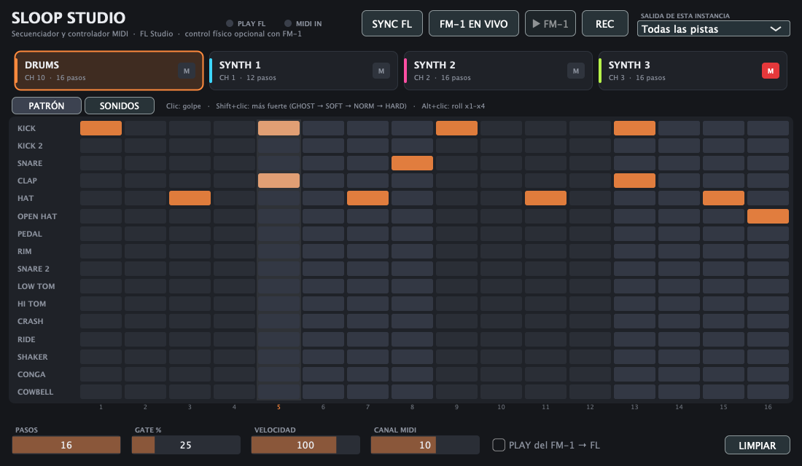
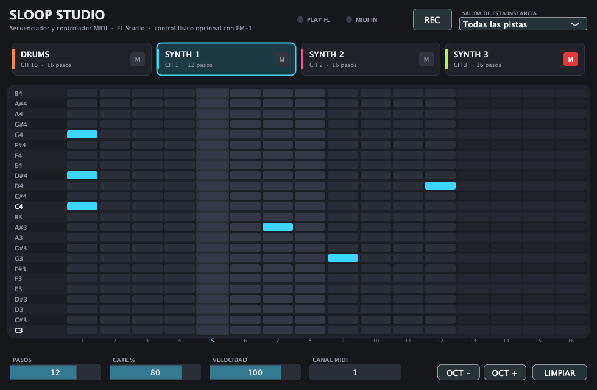
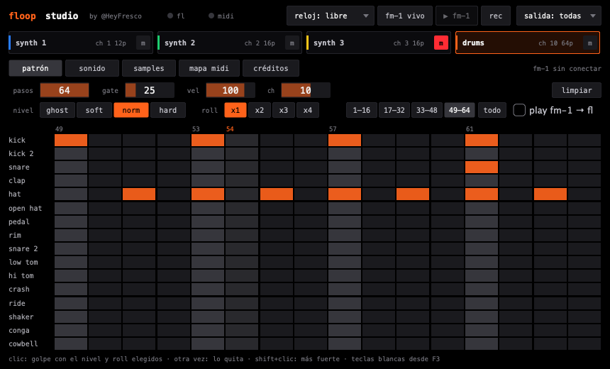
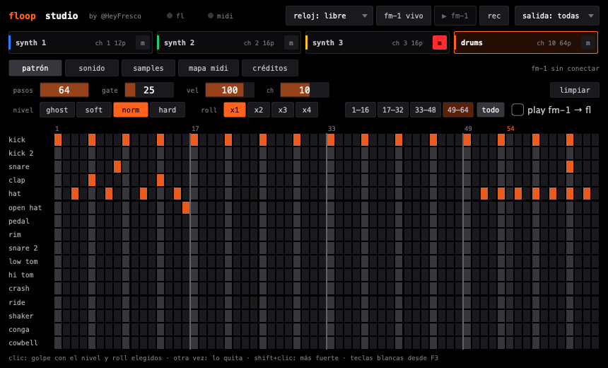
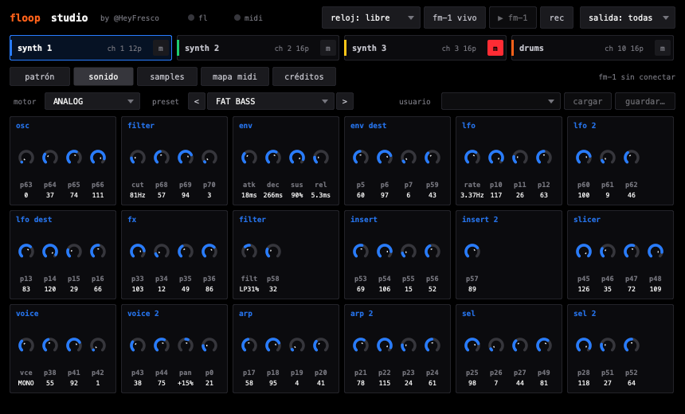
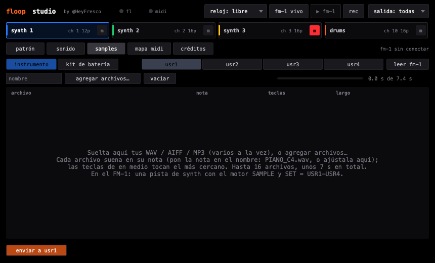
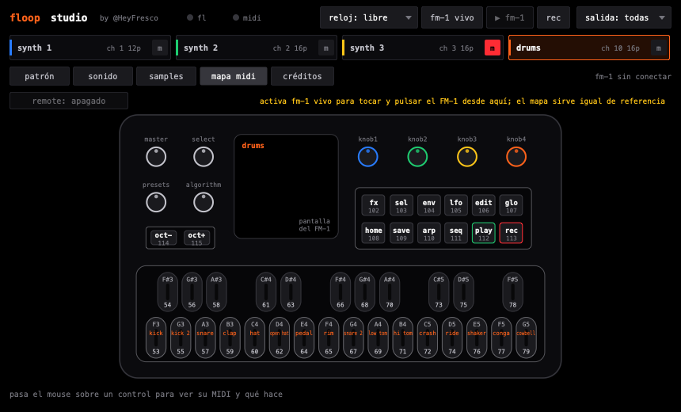
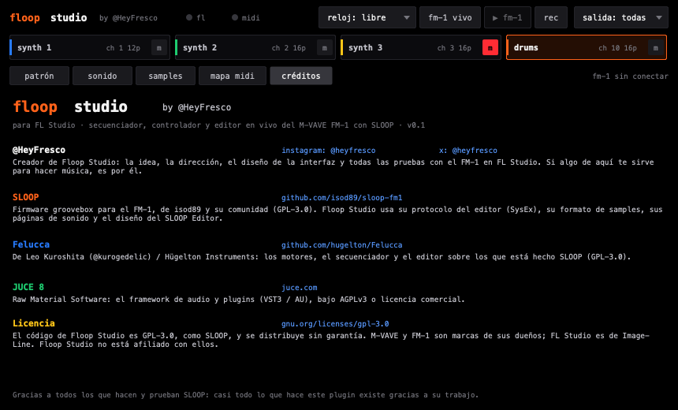

# Floop Studio — by @HeyFresco

[Español](README.md) · **English** · [Português](README.pt.md)

Floop Studio is a plugin for **FL Studio** (VST3 / AU, macOS) with two parts:

- A **4-track MIDI step sequencer**: synth 1, synth 2, synth 3 and drums, up to 64 steps each.
- A **live editor and controller for the M-VAVE FM-1** running the [SLOOP](https://github.com/isod89/sloop-fm1) firmware.

**It makes no sound.** It sends MIDI notes to whichever FL instruments you pick (Serum, Surge XT, Vital, Kontakt…). The FM-1 is optional. You can use it as a keyboard, as a controller, and as a second groovebox in sync.

This is my first plugin. Follow me on Instagram [@heyfresco](https://instagram.com/heyfresco) and on X [@heyfresco](https://x.com/heyfresco).

> The plugin's interface is in Spanish. This guide writes each on-screen label as it appears, followed by its meaning.



## Contents

- [The window](#the-window)
- [patrón (pattern): the sequencer](#patrón-pattern-the-sequencer)
- [fm-1 vivo (live): the FM-1 link](#fm-1-vivo-live-the-fm-1-link)
- [reloj (clock), play and rec](#reloj-clock-play-and-rec)
- [sonido (sound)](#sonido-sound)
- [samples](#samples)
- [mapa midi (MIDI map)](#mapa-midi-midi-map)
- [créditos (credits)](#créditos-credits)
- [Install](#install)
- [Connecting it in FL Studio](#connecting-it-in-fl-studio)
- [Recording the FM-1's audio in FL](#recording-the-fm-1s-audio-in-fl)
- [What has been tested](#what-has-been-tested)
- [License](#license)

## The window

The window is 860×520 and follows the SLOOP Editor's style. It is laid out in rows:

1. **Header:**
   - the name, plus the `fl` light (FL's transport) and the `midi` light (incoming notes);
   - **reloj** (clock), **fm-1 vivo** (live link), **▶ fm-1**, **rec**;
   - **salida** (output): which tracks this instance sends.
2. **Tracks:** synth 1, synth 2, synth 3 and **drums as the 4th track**, as on the FM-1. Each shows its channel, its length and its mute (`m`).
3. **Tabs:** `patrón · sonido · samples · mapa midi · créditos` (pattern, sound, samples, MIDI map, credits). The FM-1's connection status is shown on the right.

## patrón (pattern): the sequencer

| Track | What it does | Default MIDI channel |
|---|---|---|
| synth 1–3 | 2-octave grid × up to 64 steps, chords allowed, `octava −/+` to move by octave | 1, 2, 3 |
| drums | 16 sounds × up to 64 steps, in SLOOP's lane order (kick, kick 2, snare, clap, hat…), as GM notes | 10 |



- **Per-track settings:** `pasos` (steps, 1–64), `gate`, `vel`, `ch` and `limpiar` (clear).
- **Polyrhythms:** tracks with different lengths drift against each other.
- **Timing:** steps follow FL's song position (1 step = a 16th note), so they always land on the grid, even after a loop, a jump or a tempo change.

### 64 steps: pages and full view



- **1–16 · 17–32 · 33–48 · 49–64:** choose the page you see.
  - Pages past the track's length are dimmed.
  - The page the playhead is on is highlighted in the track's colour.
- **todo (all):** shows all 64 steps at once, with a line between bars. You can paint there too.



Projects saved with 16 steps open as before. New projects save all 64.

### Levels and rolls on drums

The drums grid has two brushes, as in the SLOOP Editor:

- **nivel (level):** ghost (vel 35), soft (70), norm (the track's `vel`) and hard (127).
- **roll:** x1–x4.

To paint:

- **Click:** places a hit with the current brush. Clicking the same hit again removes it.
- **Drag:** paints or erases several hits in a row.
- **Shift+click:** raises a hit by one level.

Colour strength shows the level (hard has an outline) and the subdivisions show the roll.

## fm-1 vivo (live): the FM-1 link

**fm-1 vivo** links the plugin to the FM-1 over USB. It uses the same SysEx protocol as the SLOOP Editor web app.

- **On connect:** the plugin takes the FM-1's pattern, with hits, levels, rolls, notes, and each track's length and mute. If you had already painted something, it asks first.
- **Plugin → FM-1:** every edit is written to the device right away.
- **FM-1 → plugin:** whatever you record, erase or load on the FM-1 shows up here.
  - The selected track updates instantly.
  - The others are re-read every 2.5 s.
- **Selected track:** picking a track here selects it on the FM-1, and the other way round.
- **Conflicts:** if both change the same step at the same moment, the plugin wins.
- **If the connection drops:** the link retries every 2 s.
- **Several instances:** they share one link, which stays active even when the window is closed.

**FM-1 limits:**

- Synth steps hold up to 4 notes.
- Tied notes (TIE) are not shown yet.
- When you write a synth step from here, its accents and slides are reset to NORM.

## reloj (clock), play and rec

The **reloj** selector decides who sets the tempo. When you change it, the FM-1 goes back to its previous settings.

| reloj | What happens |
|---|---|
| **libre** (free) | Each one runs its own tempo. |
| **fl → fm-1** | FL sends its clock and PLAY/STOP to the FM-1. The plugin sets SYNC = USB on the FM-1, and the FM-1 starts on FL's next bar line. |
| **fm-1 → fl** | The FM-1 sends its tempo, START and STOP to FL. The plugin sets SYNC = INT and CLOCK = ON on the FM-1. In FL, set *Options → MIDI Settings → External sync = MIDI clock*, with the *Felucca* input enabled. |

- **▶ fm-1:** the FM-1's PLAY/STOP, like its button.
- **rec:**
  - With fm-1 vivo, it is the FM-1's REC and lights up with the device's state.
  - Without the link, it records what you play on the FM-1 into the plugin.

### The FM-1's play starts FL

In `patrón`, the **play fm-1 → fl** toggle makes the FM-1's PLAY and STOP start and stop FL. A plugin can't move FL's transport, so a controller script does it:

1. Copy `Scripts/FL/device_Floop_Studio.py` to `Settings/Hardware/Floop Studio/` inside FL's user data folder.
2. With Floop Studio loaded, open **Options → MIDI Settings → Input**:
   - select the **Floop Studio** port;
   - set *Controller type* to **Floop Studio**;
   - click **Enable**.

The plugin sends CC 118 (play) and CC 119 (stop) on channel 16. If FL is already in that state, nothing is sent, so there is no echo.

## sonido (sound)

This is the SLOOP Editor's *Sound* page for the selected track. It needs fm-1 vivo.



- **motor (engine) and preset:** SLOOP's 12 engines and their factory presets.
- **Knob pages:**
  - the engine's two pages;
  - ENV, ENV DEST, LFO, LFO 2, LFO DEST, FX, FILTER, INSERT, SLICER, VOICE, ARP and SEL.
  - Values read as on the device (ms, Hz, dB, %, names).
- **Using the knobs:**
  - drag up or down (hold Shift for fine control);
  - the mouse wheel moves one step;
  - double-click resets to the default.
  - Changes go to and come from the FM-1 instantly.
- **drums:** kit (including USR1–4), pan, global level, reverb and delay, filter, insert and slicer.
- **usuario (user):** the FM-1's 32 user presets, with *cargar* (load) and *guardar…* (save).

## samples

This does the same as the SLOOP Editor's *Samples* and *Drum kit* pages: it uploads your sounds to the FM-1's 4 slots (USR1–USR4, about 7.4 s each).



- **instrumento (instrument):** up to 16 files (WAV, AIFF, MP3, FLAC…), each on its own note.
  - The note is read from the file name (`PIANO_C4.wav`) or set with −/+.
- **kit de batería (drum kit):** 16 pads, from KICK on F3 to COWBELL on G5.
  - If you drop several files at once, they are placed by their names.
  - If they don't fit, the longest sounds are trimmed with a fade.
- **enviar a USRn (send to USRn):** before it erases that slot, it shows you what is in it and asks you to confirm.

The format matches SLOOP's byte for byte: mono, 22050 Hz, IMA ADPCM.

## mapa midi (MIDI map)

The FM-1 drawn with its real layout, the one in M-VAVE's manual. It shows each control's MIDI under SLOOP. Hovering over a control explains what it does.



| Control | MIDI |
|---|---|
| 27 keys | 53–79 at octave 0 (the reference for FX CH). When played, the FM-1 sends the sounding note, which moves with OCT and transpose. |
| 14 buttons (REMOTE) | CC 102 FX · 103 SEL · 104 ENV · 105 LFO · 106 EDIT · 107 GLO · 108 HOME · 109 SAVE · 110 ARP · 111 SEQ · 112 PLAY · 113 REC · 114 OCT− · 115 OCT+ |
| Knobs | Send no MIDI under SLOOP. The sonido tab sees their changes. |

- **remote:** turns on REMOTE on the FM-1, on channel 16. With remote on:
  - clicking a button in the drawing presses it on the FM-1;
  - holding the click holds the button, so the button layers work too.
- **Clicking a key:** plays it on the FM-1.
- **Playing on the FM-1:** the keys light up in the drawing, and the last note and its channel appear above.

## créditos (credits)



- **@HeyFresco** ([Instagram](https://instagram.com/heyfresco) · [X](https://x.com/heyfresco)): creator of Floop Studio (idea, direction, design and testing with the FM-1).
- **[SLOOP](https://github.com/isod89/sloop-fm1):** by isod89 and its community (GPL-3.0). Floop Studio uses its protocol, its sample format and the SLOOP Editor's design.
- **[Felucca](https://github.com/hugelton/Felucca):** by Leo Kuroshita / Hügelton Instruments, which SLOOP is built on.
- **[JUCE 8](https://juce.com):** the plugin framework.

## Install

1. Copy the built plugins to your plugin folders:
   - `Floop Studio.vst3` → `~/Library/Audio/Plug-Ins/VST3/`
   - `Floop Studio.component` → `~/Library/Audio/Plug-Ins/Components/`
2. In FL Studio, open **Options → Manage plugins → Find installed plugins**. It shows up as the **Floop Studio** generator.

Building needs CMake and the Xcode Command Line Tools. The first time, get JUCE:

```bash
git clone --depth 1 --branch 8.0.15 https://github.com/juce-framework/JUCE external/JUCE
```

```bash
cmake -S . -B build -G "Unix Makefiles" -DCMAKE_BUILD_TYPE=Release
```

```bash
cmake --build build -j8
```

The build copies the plugins into those folders automatically.

## Connecting it in FL Studio

FL gives each plugin **one MIDI output port**. FL's native instruments (FPC, FLEX…) have no MIDI input port, so the plugin works directly with VST, AU and CLAP instruments. FPC or FLEX need Patcher, which hasn't been tested yet.

**One instance → one instrument:**

1. Add **Floop Studio** to the Channel Rack.
2. Open the plugin's settings (the gear) and, under MIDI, set **Output port = 0**.
3. Add a VST instrument (Surge XT, Serum…) and set its **Input port = 0**.
4. Paint a pattern and press Play in FL.

**Each track to its own instrument:** all instances share the same pattern. In each instance, use **salida** to choose which track it sends, and give it its own port:

| Instance | salida | Output port | Instrument | Input port |
|---|---|---|---|---|
| #1 | synth 1 only | 1 | Serum | 1 |
| #2 | synth 2 only | 2 | Surge XT | 2 |
| #3 | synth 3 only | 3 | Vital | 3 |
| #4 | drums only | 4 | drum VST | 4 |

**The FM-1 as a keyboard:**

1. In **Options → MIDI Settings → Input**, enable the *Felucca* port.
2. Select the Floop Studio instance in the Channel Rack.
3. What you play sounds on the selected track. With **rec** on and FL playing, it is recorded to the nearest step.

## Recording the FM-1's audio in FL

Over USB, the FM-1 is also an audio input (*Felucca*, stereo, no driver needed).

1. In **Audio MIDI Setup** (Mac), create an **aggregate device** with *Felucca* as input and your audio output.
2. In **FL → Options → Audio Settings**, choose that device.
3. In the Mixer, on a free insert, pick the *Felucca* input, arm recording and press REC.

With **reloj: fl → fm-1**, what you record lands in time with FL.

## What has been tested

**Automated tests:**

- `ctest`: the engine (exact grid timing at any buffer size, gate, chords, loops, mute, 64 steps, saving) and the sample format, compared against SLOOP's `sampleio.py`.
- `auval`: AU VALIDATION SUCCEEDED.
- `sloop_host_check`: loads the VST3 and checks its MIDI.
- `sloop_ui_snapshot`: renders the screenshots in `docs/`.

**Tested in FL Studio 2026:** the plugin loads, follows the transport, and its MIDI reaches Surge XT. The FL script loads without errors, and with **play fm-1 → fl** the FM-1's PLAY and STOP start and stop FL (20 Nov 2026).

**Tested with a real FM-1 (SLOOP 2.8.5), using `sloop_fm1_probe`:**

- reading and writing the pattern;
- the live link and the selected track;
- the clock in both directions;
- ▶ fm-1 and rec;
- reading and writing sound;
- uploading samples;
- REMOTE and the keys;
- the play bridge.

**Not tested yet:**

- External sync (reloj fm-1 → fl) inside FL;
- 64 steps with the FM-1;
- loading and saving user presets on the device;
- FPC or FLEX through Patcher.

## License

Floop Studio's code is **GPL-3.0**, like SLOOP. JUCE 8 is available under AGPLv3 or a commercial licence. M-VAVE and FM-1 are trademarks of their owners, and FL Studio belongs to Image-Line. Floop Studio is not affiliated with them.
