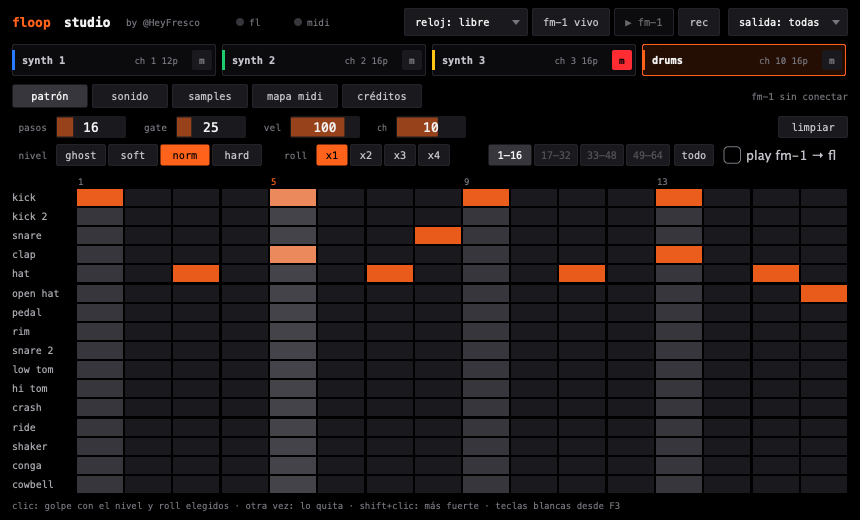
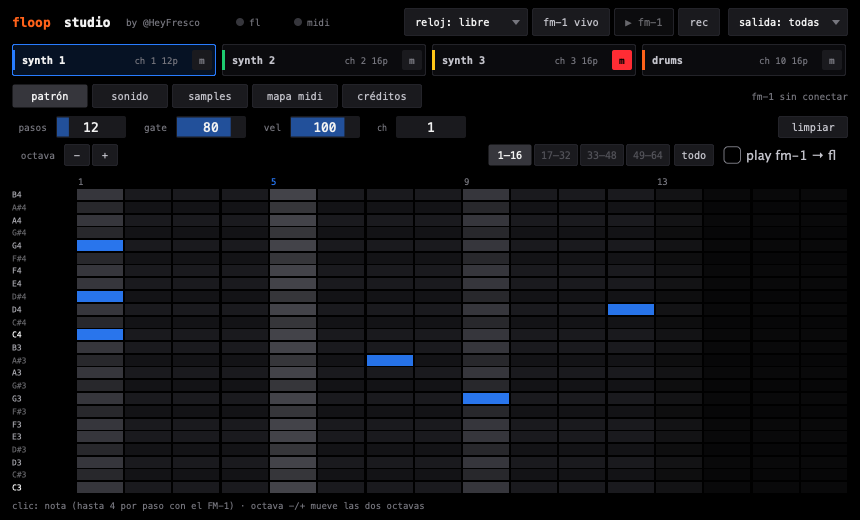
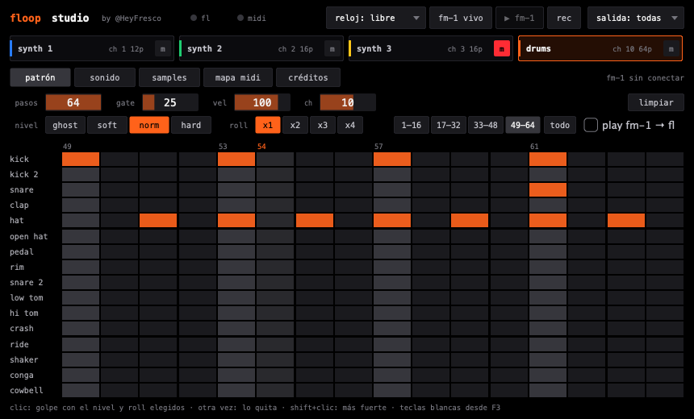
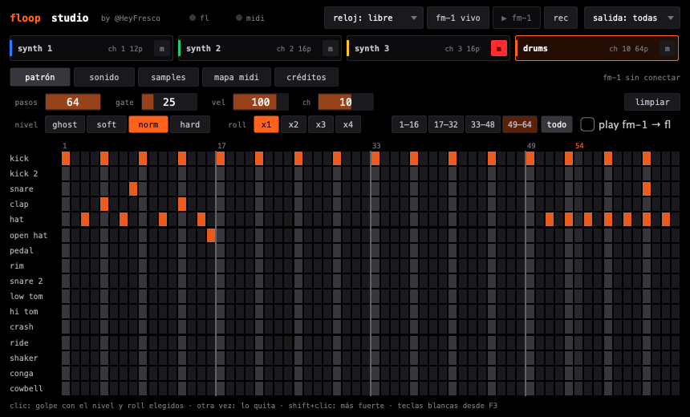
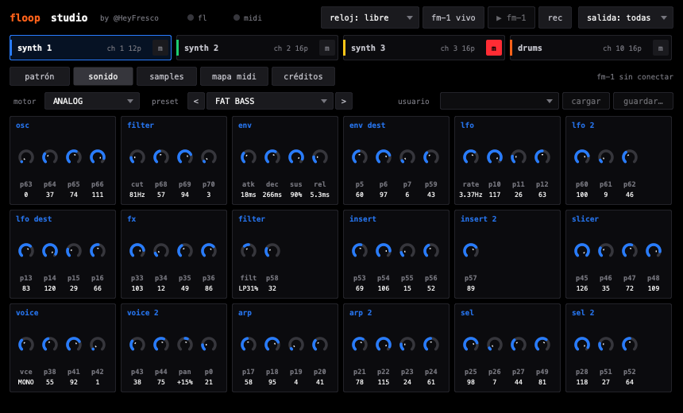
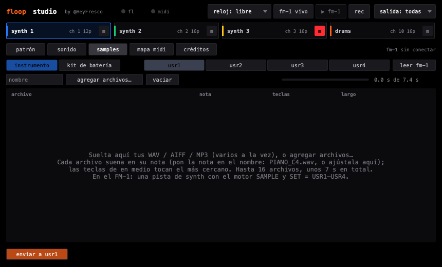
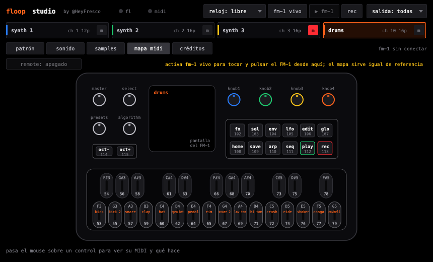
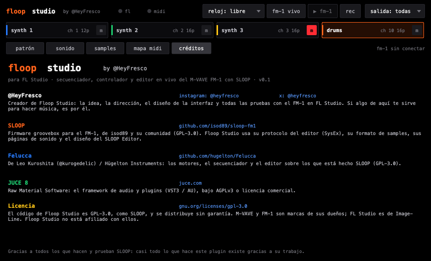

# Floop Studio — by @HeyFresco

**Español** · [English](README.en.md) · [Português](README.pt.md)

Floop Studio es un plugin para **FL Studio** (VST3 / AU, macOS) con dos partes:

- Un **secuenciador MIDI de 4 pistas**: synth 1, synth 2, synth 3 y drums, de hasta 64 pasos.
- Un **editor y controlador en vivo del M-VAVE FM-1** con el firmware [SLOOP](https://github.com/isod89/sloop-fm1).

**No produce sonido.** Manda notas MIDI a los instrumentos de FL que elijas (Serum, Surge XT, Vital, Kontakt…). El FM-1 es opcional: sirve como teclado, como controlador y como segunda groovebox sincronizada.

Es mi primer plugin. Sígueme en Instagram [@heyfresco](https://instagram.com/heyfresco) y en X [@heyfresco](https://x.com/heyfresco).



## Contenido

- [La ventana](#la-ventana)
- [patrón: el secuenciador](#patrón-el-secuenciador)
- [fm-1 vivo: el enlace con el FM-1](#fm-1-vivo-el-enlace-con-el-fm-1)
- [reloj, play y rec](#reloj-play-y-rec)
- [sonido](#sonido)
- [samples](#samples)
- [mapa midi](#mapa-midi)
- [créditos](#créditos)
- [Instalar](#instalar)
- [Conectarlo en FL Studio](#conectarlo-en-fl-studio)
- [Grabar el audio del FM-1 en FL](#grabar-el-audio-del-fm-1-en-fl)
- [Qué está probado](#qué-está-probado)
- [Licencia](#licencia)

## La ventana

La ventana mide 860×520 y sigue el estilo del SLOOP Editor. Está ordenada en filas:

1. **Cabecera:**
   - el nombre y las luces `fl` (transporte de FL) y `midi` (llegan notas);
   - **reloj**, **fm-1 vivo**, **▶ fm-1**, **rec**;
   - **salida**: qué pistas manda esta instancia.
2. **Pistas:** synth 1, synth 2, synth 3 y **drums como la 4.ª**, igual que en el FM-1. Cada una muestra su canal, sus pasos y su mute (`m`).
3. **Pestañas:** `patrón · sonido · samples · mapa midi · créditos`. A la derecha se ve el estado del FM-1.

## patrón: el secuenciador

| Pista | Qué hace | Canal MIDI por defecto |
|---|---|---|
| synth 1–3 | Cuadrícula de 2 octavas × hasta 64 pasos, con acordes, y `octava −/+` para moverte | 1, 2, 3 |
| drums | 16 sonidos × hasta 64 pasos, en el orden de carriles de SLOOP (kick, kick 2, snare, clap, hat…), en notas GM | 10 |



- **Ajustes por pista:** `pasos` (1–64), `gate`, `vel`, `ch` y `limpiar`.
- **Polirritmos:** las pistas de largo distinto se desfasan entre sí.
- **Sincronía:** los pasos siguen la posición de FL (1 paso = semicorchea), así que siempre caen en la rejilla, también después de un loop, un salto o un cambio de tempo.

### 64 pasos: páginas y vista completa



- **1–16 · 17–32 · 33–48 · 49–64:** cambian la página que ves.
  - Las páginas que pasan del largo de la pista se ven atenuadas.
  - La página donde va el cursor se resalta en el color de la pista.
- **todo:** muestra los 64 pasos a la vez, con una línea entre compases. También se puede pintar ahí.



Los proyectos guardados con 16 pasos se abren igual. Los nuevos guardan los 64.

### Niveles y roll en drums

Sobre la cuadrícula de drums hay dos pinceles, como en el SLOOP Editor:

- **nivel:** ghost (vel 35), soft (70), norm (la `vel` de la pista) y hard (127).
- **roll:** x1–x4.

Para pintar:

- **Clic:** pone un golpe con el pincel elegido. Hacer clic otra vez en el mismo golpe lo quita.
- **Arrastrar:** pinta o borra varios golpes seguidos.
- **Shift+clic:** sube el golpe un nivel.

La intensidad del color indica el nivel (hard lleva borde) y las divisiones indican el roll.

## fm-1 vivo: el enlace con el FM-1

**fm-1 vivo** conecta el plugin con el FM-1 por USB. Usa el mismo protocolo SysEx que el SLOOP Editor web.

- **Al conectar:** el plugin toma el patrón del FM-1, con golpes, niveles, roll, notas, largo y mute de cada pista. Si ya tenías algo pintado, primero te pide confirmación.
- **Del plugin al FM-1:** cada cambio se escribe en el equipo al momento.
- **Del FM-1 al plugin:** lo que grabes, borres o cargues en el FM-1 aparece aquí.
  - La pista seleccionada se actualiza al instante.
  - Las demás se releen cada 2,5 s.
- **Pista seleccionada:** elegir una pista aquí la selecciona en el FM-1, y al revés.
- **Conflictos:** si los dos cambian el mismo paso a la vez, gana el plugin.
- **Si se cae la conexión:** el enlace reintenta cada 2 s.
- **Varias instancias:** comparten un solo enlace, que sigue activo aunque cierres la ventana.

**Límites del FM-1:**

- En los synths caben 4 notas por paso.
- Las notas ligadas (TIE) aún no se muestran.
- Al escribir un paso de synth desde aquí, sus acentos y slides quedan en NORM.

## reloj, play y rec

El selector **reloj** decide quién manda el tempo. Al cambiar de opción, el FM-1 vuelve a sus ajustes de antes.

| reloj | Qué pasa |
|---|---|
| **libre** | Cada uno con su tempo. |
| **fl → fm-1** | FL manda su reloj y su PLAY/STOP al FM-1. El plugin pone SYNC = USB en el FM-1, y el FM-1 entra en la siguiente barra de compás de FL. |
| **fm-1 → fl** | El FM-1 manda su tempo, START y STOP a FL. El plugin pone en el FM-1 SYNC = INT y CLOCK = ON. En FL hay que activar *Options → MIDI Settings → External sync = MIDI clock*, con la entrada *Felucca* activada. |

- **▶ fm-1:** es el PLAY/STOP del FM-1, como su botón.
- **rec:**
  - Con fm-1 vivo, es el REC del FM-1 y se ilumina según el estado del equipo.
  - Sin enlace, graba en el plugin lo que tocas en el FM-1.

### El play del FM-1 arranca FL

En `patrón`, el interruptor **play fm-1 → fl** hace que el PLAY y STOP del FM-1 arranquen y detengan FL. Un plugin no puede mover el transporte de FL, así que esto lo hace un script de controlador:

1. Copia `Scripts/FL/device_Floop_Studio.py` a `Settings/Hardware/Floop Studio/`, dentro de la carpeta de datos de usuario de FL.
2. Con Floop Studio cargado, ve a **Options → MIDI Settings → Input**:
   - selecciona el puerto **Floop Studio**;
   - en *Controller type* elige **Floop Studio**;
   - pulsa **Enable**.

El plugin manda CC 118 (play) y CC 119 (stop) por el canal 16. Si FL ya está en ese estado, no manda nada, así que no hay eco.

## sonido

Es la página *Sound* del SLOOP Editor para la pista seleccionada. Necesita fm-1 vivo.



- **motor y preset:** los 12 motores de SLOOP y sus presets de fábrica.
- **Páginas de perillas:**
  - las dos del motor;
  - ENV, ENV DEST, LFO, LFO 2, LFO DEST, FX, FILTER, INSERT, SLICER, VOICE, ARP y SEL.
  - Los valores se muestran como en el equipo (ms, Hz, dB, %, nombres).
- **Cómo usar las perillas:**
  - arrastra arriba o abajo (con Shift, el ajuste es fino);
  - la rueda mueve un paso;
  - el doble clic vuelve al valor por defecto.
  - Los cambios van y vienen del FM-1 al instante.
- **drums:** kit (incluye USR1–4), paneo, nivel, reverb y delay globales, filtro, insert y slicer.
- **usuario:** los 32 presets de usuario del FM-1, con *cargar* y *guardar…*.

## samples

Hace lo mismo que las páginas *Samples* y *Drum kit* del SLOOP Editor: sube tus sonidos a los 4 espacios del FM-1 (USR1–USR4, unos 7,4 s cada uno).



- **instrumento:** hasta 16 archivos (WAV, AIFF, MP3, FLAC…), cada uno en su nota.
  - La nota se toma del nombre del archivo (`PIANO_C4.wav`) o se ajusta con −/+.
- **kit de batería:** 16 pads, de KICK en F3 a COWBELL en G5.
  - Si sueltas varios archivos a la vez, se reparten según su nombre.
  - Si no caben, los sonidos más largos se recortan con un fundido.
- **enviar a USRn:** antes de borrar ese espacio, te muestra qué tiene y pide confirmación.

El formato es el de SLOOP byte por byte: mono, 22050 Hz, IMA ADPCM.

## mapa midi

El FM-1 dibujado con su acomodo real, el del manual de M-VAVE. Muestra el MIDI de cada control con SLOOP. Al pasar el mouse por encima, explica qué hace cada uno.



| Control | MIDI |
|---|---|
| 27 teclas | 53–79 en octava 0 (la referencia para FX CH). Al tocar, el FM-1 envía la nota que suena, que se mueve con OCT y transpose. |
| 14 botones (REMOTE) | CC 102 FX · 103 SEL · 104 ENV · 105 LFO · 106 EDIT · 107 GLO · 108 HOME · 109 SAVE · 110 ARP · 111 SEQ · 112 PLAY · 113 REC · 114 OCT− · 115 OCT+ |
| Perillas | No envían MIDI con SLOOP. La pestaña sonido ve sus cambios. |

- **remote:** activa REMOTE en el FM-1 por el canal 16. Con remote activo:
  - hacer clic en un botón del dibujo lo pulsa en el FM-1;
  - mantener el clic mantiene el botón pulsado, así que también funcionan las capas.
- **Clic en una tecla:** la toca en el FM-1.
- **Tocar en el FM-1:** las teclas se iluminan en el dibujo, y arriba se ven la última nota y su canal.

## créditos



- **@HeyFresco** ([Instagram](https://instagram.com/heyfresco) · [X](https://x.com/heyfresco)): creador de Floop Studio (idea, dirección, diseño y pruebas con el FM-1).
- **[SLOOP](https://github.com/isod89/sloop-fm1):** de isod89 y su comunidad (GPL-3.0). Floop Studio usa su protocolo, su formato de samples y el diseño del SLOOP Editor.
- **[Felucca](https://github.com/hugelton/Felucca):** de Leo Kuroshita / Hügelton Instruments, la base de SLOOP.
- **[JUCE 8](https://juce.com):** el framework del plugin.

## Instalar

1. Copia los plugins compilados a tu carpeta de plugins:
   - `Floop Studio.vst3` → `~/Library/Audio/Plug-Ins/VST3/`
   - `Floop Studio.component` → `~/Library/Audio/Plug-Ins/Components/`
2. En FL Studio, ve a **Options → Manage plugins → Find installed plugins**. Aparece como el generador **Floop Studio**.

Para compilar necesitas CMake y las Command Line Tools de Xcode. La primera vez, descarga JUCE:

```bash
git clone --depth 1 --branch 8.0.15 https://github.com/juce-framework/JUCE external/JUCE
```

```bash
cmake -S . -B build -G "Unix Makefiles" -DCMAKE_BUILD_TYPE=Release
```

```bash
cmake --build build -j8
```

Al compilar, los plugins se copian solos a esas carpetas.

## Conectarlo en FL Studio

FL da **un puerto MIDI de salida por plugin**. Los instrumentos nativos de FL (FPC, FLEX…) no tienen puerto de entrada MIDI, así que el plugin funciona directo con VST, AU y CLAP. Para FPC o FLEX se usa Patcher, pero eso aún no está probado.

**Una instancia → un instrumento:**

1. Agrega **Floop Studio** al Channel Rack.
2. Abre la configuración del plugin (el engrane) y, en la sección MIDI, pon **Output port = 0**.
3. Agrega un instrumento VST (Surge XT, Serum…) y pon su **Input port = 0**.
4. Pinta un patrón y dale Play en FL.

**Cada pista a su instrumento:** todas las instancias comparten el mismo patrón. En cada instancia, elige qué pista manda con **salida** y dale un puerto propio:

| Instancia | salida | Output port | Instrumento | Input port |
|---|---|---|---|---|
| #1 | solo synth 1 | 1 | Serum | 1 |
| #2 | solo synth 2 | 2 | Surge XT | 2 |
| #3 | solo synth 3 | 3 | Vital | 3 |
| #4 | solo drums | 4 | batería VST | 4 |

**El FM-1 como teclado:**

1. En **Options → MIDI Settings → Input**, activa el puerto *Felucca*.
2. Selecciona en el Channel Rack la instancia de Floop Studio.
3. Lo que tocas suena en la pista seleccionada. Con **rec** y Play en FL, se graba en el paso más cercano.

## Grabar el audio del FM-1 en FL

Por USB, el FM-1 también es una entrada de audio (*Felucca*, estéreo, no necesita driver).

1. En **Configuración de Audio MIDI** (Mac), crea un **dispositivo agregado** con *Felucca* como entrada y tu salida de audio.
2. En **FL → Options → Audio Settings**, elige ese dispositivo.
3. En el Mixer, en un insert libre, elige la entrada *Felucca*, arma la grabación y dale REC.

Con **reloj: fl → fm-1**, lo que grabes cae a tiempo con FL.

## Qué está probado

**Pruebas automáticas:**

- `ctest`: motor (rejilla exacta con cualquier buffer, gate, acordes, loops, mute, 64 pasos, guardado) y formato de samples comparado con `sampleio.py` de SLOOP.
- `auval`: AU VALIDATION SUCCEEDED.
- `sloop_host_check`: carga el VST3 y comprueba su MIDI.
- `sloop_ui_snapshot`: genera las capturas de `docs/`.

**Probado en FL Studio 2026:** el plugin carga, sigue el transporte y su MIDI llega a Surge XT.

**Probado con un FM-1 real (SLOOP 2.8.5), usando `sloop_fm1_probe`:**

- leer y escribir el patrón;
- el enlace en vivo y la pista seleccionada;
- el reloj en los dos sentidos;
- ▶ fm-1 y rec;
- leer y escribir sonido;
- subir samples;
- REMOTE y las teclas;
- el puente de play.

**Aún no probado:**

- el puente de play y External sync dentro de FL;
- 64 pasos con el FM-1;
- cargar y guardar presets de usuario con el equipo;
- FPC o FLEX vía Patcher.

## Licencia

El código de Floop Studio es **GPL-3.0**, como SLOOP. JUCE 8 se distribuye bajo AGPLv3 o licencia comercial. M-VAVE y FM-1 son marcas de sus dueños, y FL Studio es de Image-Line. Floop Studio no está afiliado con ellos.
