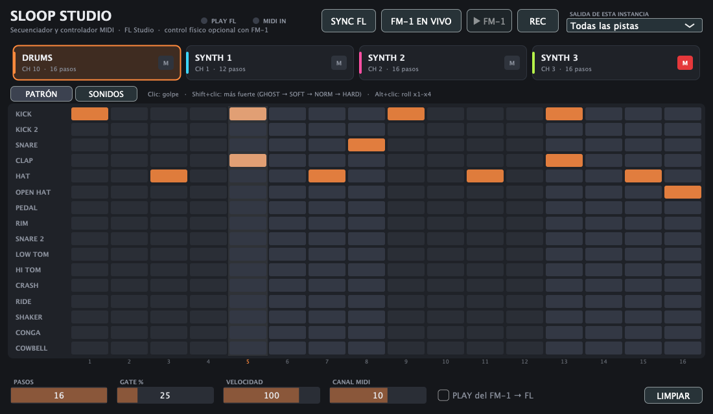
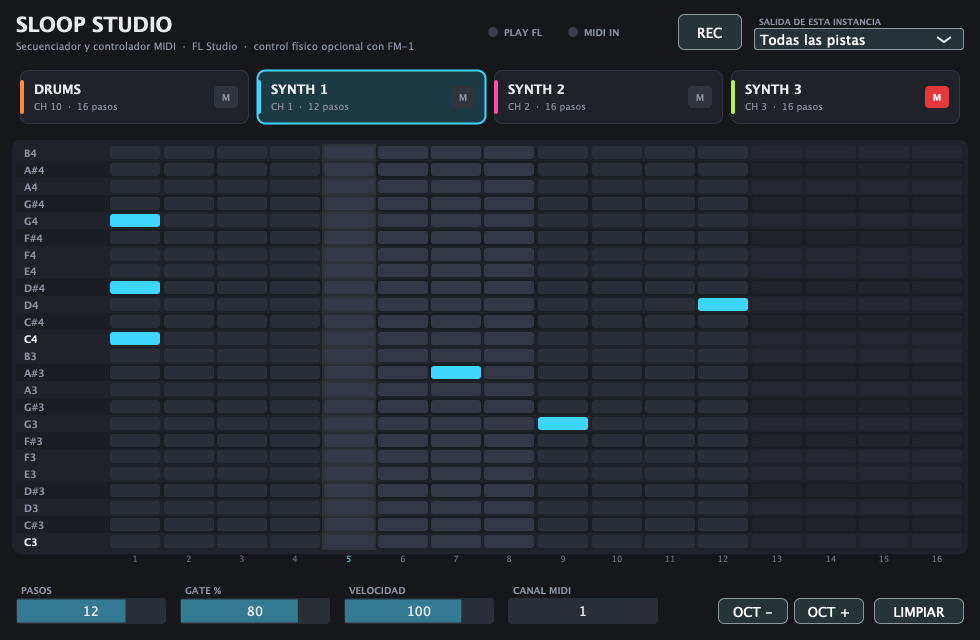
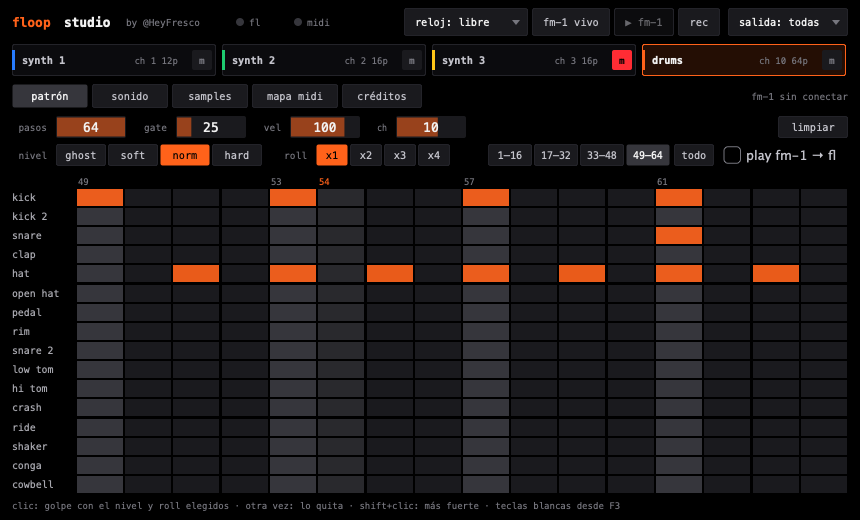
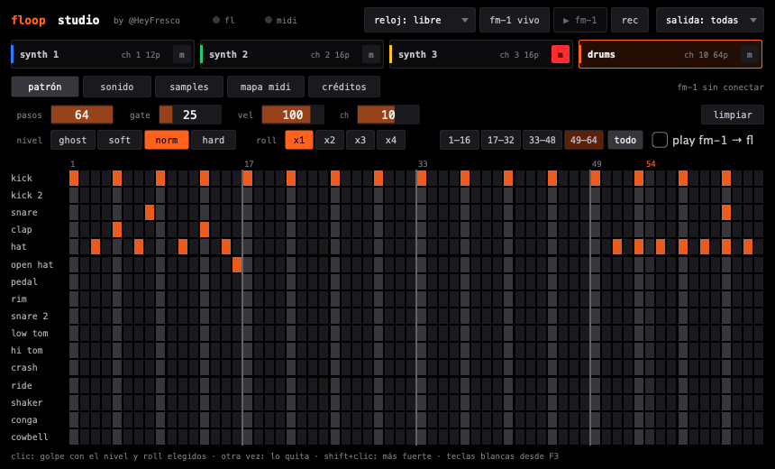
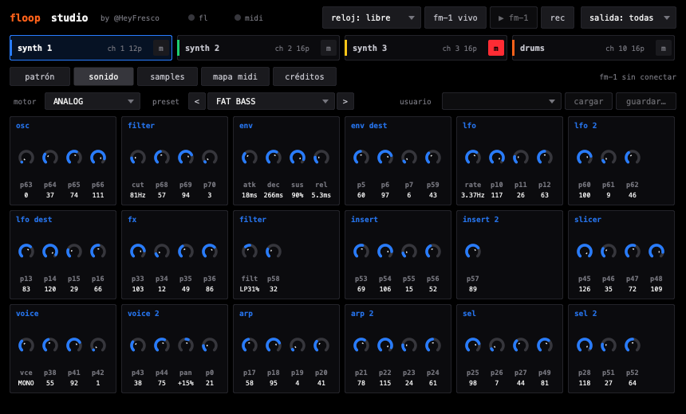
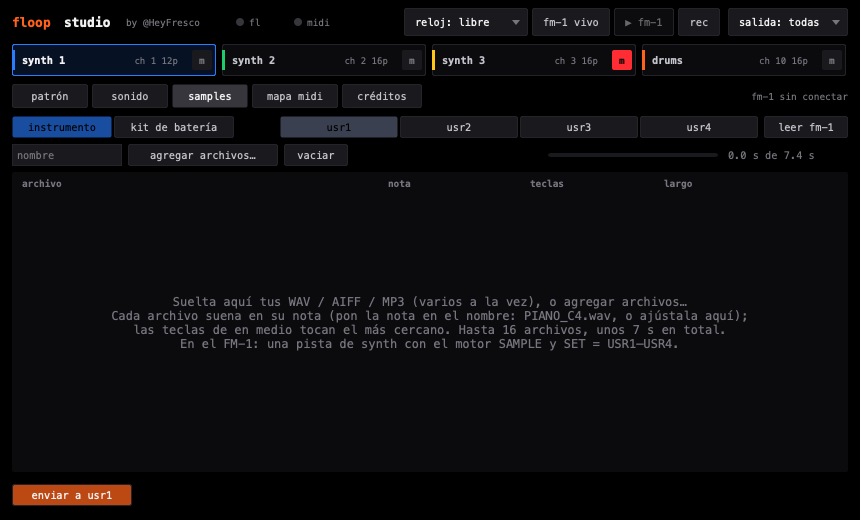
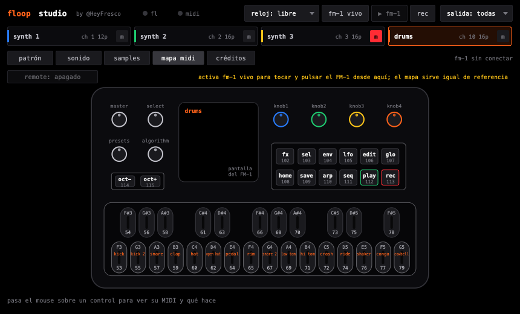
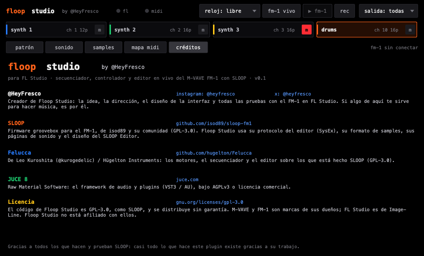

# Floop Studio — by @HeyFresco

[Español](README.md) · [English](README.en.md) · **Português**

Floop Studio é um plugin para o **FL Studio** (VST3 / AU, macOS) com duas partes:

- Um **sequenciador MIDI de 4 faixas**: synth 1, synth 2, synth 3 e drums, com até 64 passos.
- Um **editor e controlador ao vivo do M-VAVE FM-1** com o firmware [SLOOP](https://github.com/isod89/sloop-fm1).

**Ele não produz som.** Envia notas MIDI para os instrumentos do FL que você escolher (Serum, Surge XT, Vital, Kontakt…). O FM-1 é opcional: serve como teclado, como controlador e como uma segunda groovebox sincronizada.

Este é o meu primeiro plugin. Me siga no Instagram [@heyfresco](https://instagram.com/heyfresco) e no X [@heyfresco](https://x.com/heyfresco).

> A interface do plugin está em espanhol. Este guia escreve cada rótulo como aparece na tela, seguido do seu significado.



## Conteúdo

- [A janela](#a-janela)
- [patrón (padrão): o sequenciador](#patrón-padrão-o-sequenciador)
- [fm-1 vivo (ao vivo): a conexão com o FM-1](#fm-1-vivo-ao-vivo-a-conexão-com-o-fm-1)
- [reloj (relógio), play e rec](#reloj-relógio-play-e-rec)
- [sonido (som)](#sonido-som)
- [samples](#samples)
- [mapa midi](#mapa-midi)
- [créditos](#créditos)
- [Instalar](#instalar)
- [Conectar no FL Studio](#conectar-no-fl-studio)
- [Gravar o áudio do FM-1 no FL](#gravar-o-áudio-do-fm-1-no-fl)
- [O que foi testado](#o-que-foi-testado)
- [Licença](#licença)

## A janela

A janela tem 860×520 e segue o estilo do SLOOP Editor. Está organizada em linhas:

1. **Cabeçalho:**
   - o nome e as luzes `fl` (transporte do FL) e `midi` (notas chegando);
   - **reloj** (relógio), **fm-1 vivo** (conexão ao vivo), **▶ fm-1**, **rec**;
   - **salida** (saída): quais faixas esta instância envia.
2. **Faixas:** synth 1, synth 2, synth 3 e **drums como a 4.ª**, igual ao FM-1. Cada uma mostra seu canal, seus passos e seu mute (`m`).
3. **Abas:** `patrón · sonido · samples · mapa midi · créditos` (padrão, som, samples, mapa MIDI, créditos). À direita aparece o estado da conexão com o FM-1.

## patrón (padrão): o sequenciador

| Faixa | O que faz | Canal MIDI padrão |
|---|---|---|
| synth 1–3 | Grade de 2 oitavas × até 64 passos, com acordes, e `octava −/+` para mudar de oitava | 1, 2, 3 |
| drums | 16 sons × até 64 passos, na ordem de trilhas do SLOOP (kick, kick 2, snare, clap, hat…), em notas GM | 10 |



- **Ajustes por faixa:** `pasos` (passos, 1–64), `gate`, `vel`, `ch` e `limpiar` (limpar).
- **Polirritmos:** faixas com tamanhos diferentes se defasam entre si.
- **Sincronia:** os passos seguem a posição do FL (1 passo = semicolcheia), então sempre caem na grade, mesmo depois de um loop, um salto ou uma mudança de andamento.

### 64 passos: páginas e visão completa



- **1–16 · 17–32 · 33–48 · 49–64:** escolhem a página que você vê.
  - As páginas além do tamanho da faixa aparecem apagadas.
  - A página onde está o cursor fica destacada na cor da faixa.
- **todo (tudo):** mostra os 64 passos de uma vez, com uma linha entre os compassos. Também dá para pintar ali.



Projetos salvos com 16 passos abrem como antes. Os novos salvam os 64.

### Níveis e roll no drums

Sobre a grade de drums há dois pincéis, como no SLOOP Editor:

- **nivel (nível):** ghost (vel 35), soft (70), norm (a `vel` da faixa) e hard (127).
- **roll:** x1–x4.

Para pintar:

- **Clique:** coloca uma batida com o pincel escolhido. Clicar de novo na mesma batida a remove.
- **Arrastar:** pinta ou apaga várias batidas seguidas.
- **Shift+clique:** sobe a batida um nível.

A intensidade da cor mostra o nível (hard tem borda) e as divisões mostram o roll.

## fm-1 vivo (ao vivo): a conexão com o FM-1

**fm-1 vivo** conecta o plugin ao FM-1 por USB. Usa o mesmo protocolo SysEx do SLOOP Editor web.

- **Ao conectar:** o plugin pega o padrão do FM-1, com batidas, níveis, roll, notas, e o tamanho e o mute de cada faixa. Se você já tinha algo pintado, ele pede confirmação antes.
- **Do plugin para o FM-1:** cada alteração é gravada no aparelho na hora.
- **Do FM-1 para o plugin:** o que você gravar, apagar ou carregar no FM-1 aparece aqui.
  - A faixa selecionada é atualizada na hora.
  - As outras são relidas a cada 2,5 s.
- **Faixa selecionada:** escolher uma faixa aqui a seleciona no FM-1, e vice-versa.
- **Conflitos:** se os dois mudarem o mesmo passo ao mesmo tempo, o plugin ganha.
- **Se a conexão cair:** ela tenta de novo a cada 2 s.
- **Várias instâncias:** compartilham uma única conexão, que continua ativa mesmo com a janela fechada.

**Limites do FM-1:**

- Nos synths cabem 4 notas por passo.
- Notas ligadas (TIE) ainda não aparecem.
- Ao gravar um passo de synth daqui, seus acentos e slides voltam para NORM.

## reloj (relógio), play e rec

O seletor **reloj** decide quem manda no andamento. Ao trocar de opção, o FM-1 volta às configurações de antes.

| reloj | O que acontece |
|---|---|
| **libre** (livre) | Cada um com seu andamento. |
| **fl → fm-1** | O FL envia seu clock e seu PLAY/STOP ao FM-1. O plugin coloca SYNC = USB no FM-1, e o FM-1 entra na próxima barra de compasso do FL. |
| **fm-1 → fl** | O FM-1 envia seu andamento, START e STOP ao FL. O plugin coloca no FM-1 SYNC = INT e CLOCK = ON. No FL, ative *Options → MIDI Settings → External sync = MIDI clock*, com a entrada *Felucca* ativada. |

- **▶ fm-1:** o PLAY/STOP do FM-1, como o botão dele.
- **rec:**
  - Com fm-1 vivo, é o REC do FM-1 e acende conforme o estado do aparelho.
  - Sem conexão, grava no plugin o que você toca no FM-1.

### O play do FM-1 inicia o FL

Em `patrón`, a chave **play fm-1 → fl** faz o PLAY e o STOP do FM-1 iniciarem e pararem o FL. Um plugin não consegue mover o transporte do FL, então quem faz isso é um script de controlador:

1. Copie `Scripts/FL/device_Floop_Studio.py` para `Settings/Hardware/Floop Studio/`, dentro da pasta de dados de usuário do FL.
2. Com o Floop Studio carregado, abra **Options → MIDI Settings → Input**:
   - selecione a porta **Floop Studio**;
   - em *Controller type*, escolha **Floop Studio**;
   - clique em **Enable**.

O plugin envia CC 118 (play) e CC 119 (stop) no canal 16. Se o FL já estiver nesse estado, nada é enviado, então não há eco.

## sonido (som)

É a página *Sound* do SLOOP Editor para a faixa selecionada. Precisa do fm-1 vivo.



- **motor e preset:** os 12 motores do SLOOP e seus presets de fábrica.
- **Páginas de knobs:**
  - as duas páginas do motor;
  - ENV, ENV DEST, LFO, LFO 2, LFO DEST, FX, FILTER, INSERT, SLICER, VOICE, ARP e SEL.
  - Os valores aparecem como no aparelho (ms, Hz, dB, %, nomes).
- **Como usar os knobs:**
  - arraste para cima ou para baixo (com Shift, o ajuste é fino);
  - a roda do mouse move um passo;
  - o duplo clique volta ao valor padrão.
  - As mudanças vão e vêm do FM-1 na hora.
- **drums:** kit (inclui USR1–4), pan, nível, reverb e delay globais, filtro, insert e slicer.
- **usuario (usuário):** os 32 presets de usuário do FM-1, com *cargar* (carregar) e *guardar…* (salvar).

## samples

Faz o mesmo que as páginas *Samples* e *Drum kit* do SLOOP Editor: envia seus sons para os 4 espaços do FM-1 (USR1–USR4, cerca de 7,4 s cada).



- **instrumento:** até 16 arquivos (WAV, AIFF, MP3, FLAC…), cada um na sua nota.
  - A nota vem do nome do arquivo (`PIANO_C4.wav`) ou é ajustada com −/+.
- **kit de batería (kit de bateria):** 16 pads, de KICK em F3 a COWBELL em G5.
  - Se você soltar vários arquivos de uma vez, eles são distribuídos pelo nome.
  - Se não couberem, os sons mais longos são cortados com um fade.
- **enviar a USRn (enviar para USRn):** antes de apagar esse espaço, mostra o que há nele e pede confirmação.

O formato é o do SLOOP byte a byte: mono, 22050 Hz, IMA ADPCM.

## mapa midi

O FM-1 desenhado com o layout real, o do manual da M-VAVE. Mostra o MIDI de cada controle no SLOOP. Ao passar o mouse por cima, explica o que cada um faz.



| Controle | MIDI |
|---|---|
| 27 teclas | 53–79 na oitava 0 (a referência para FX CH). Ao tocar, o FM-1 envia a nota que soa, que muda com OCT e transpose. |
| 14 botões (REMOTE) | CC 102 FX · 103 SEL · 104 ENV · 105 LFO · 106 EDIT · 107 GLO · 108 HOME · 109 SAVE · 110 ARP · 111 SEQ · 112 PLAY · 113 REC · 114 OCT− · 115 OCT+ |
| Knobs | Não enviam MIDI no SLOOP. A aba sonido vê suas mudanças. |

- **remote:** ativa o REMOTE no FM-1, no canal 16. Com o remote ativo:
  - clicar num botão do desenho o aperta no FM-1;
  - segurar o clique segura o botão, então as camadas também funcionam.
- **Clique numa tecla:** toca a tecla no FM-1.
- **Tocar no FM-1:** as teclas acendem no desenho, e acima aparecem a última nota e seu canal.

## créditos



- **@HeyFresco** ([Instagram](https://instagram.com/heyfresco) · [X](https://x.com/heyfresco)): criador do Floop Studio (ideia, direção, design e testes com o FM-1).
- **[SLOOP](https://github.com/isod89/sloop-fm1):** de isod89 e sua comunidade (GPL-3.0). O Floop Studio usa seu protocolo, seu formato de samples e o design do SLOOP Editor.
- **[Felucca](https://github.com/hugelton/Felucca):** de Leo Kuroshita / Hügelton Instruments, a base do SLOOP.
- **[JUCE 8](https://juce.com):** o framework do plugin.

## Instalar

1. Copie os plugins compilados para suas pastas de plugins:
   - `Floop Studio.vst3` → `~/Library/Audio/Plug-Ins/VST3/`
   - `Floop Studio.component` → `~/Library/Audio/Plug-Ins/Components/`
2. No FL Studio, abra **Options → Manage plugins → Find installed plugins**. Ele aparece como o gerador **Floop Studio**.

Para compilar, você precisa do CMake e das Command Line Tools do Xcode. Na primeira vez, baixe o JUCE:

```bash
git clone --depth 1 --branch 8.0.15 https://github.com/juce-framework/JUCE external/JUCE
```

```bash
cmake -S . -B build -G "Unix Makefiles" -DCMAKE_BUILD_TYPE=Release
```

```bash
cmake --build build -j8
```

A compilação copia os plugins para essas pastas automaticamente.

## Conectar no FL Studio

O FL dá **uma porta de saída MIDI por plugin**. Os instrumentos nativos do FL (FPC, FLEX…) não têm porta de entrada MIDI, então o plugin funciona direto com instrumentos VST, AU e CLAP. Para FPC ou FLEX é preciso usar o Patcher, o que ainda não foi testado.

**Uma instância → um instrumento:**

1. Adicione o **Floop Studio** ao Channel Rack.
2. Abra as configurações do plugin (a engrenagem) e, na seção MIDI, defina **Output port = 0**.
3. Adicione um instrumento VST (Surge XT, Serum…) e defina o **Input port = 0** dele.
4. Pinte um padrão e dê Play no FL.

**Cada faixa no seu instrumento:** todas as instâncias compartilham o mesmo padrão. Em cada instância, escolha com **salida** qual faixa ela envia, e dê a ela uma porta própria:

| Instância | salida | Output port | Instrumento | Input port |
|---|---|---|---|---|
| #1 | só synth 1 | 1 | Serum | 1 |
| #2 | só synth 2 | 2 | Surge XT | 2 |
| #3 | só synth 3 | 3 | Vital | 3 |
| #4 | só drums | 4 | bateria VST | 4 |

**O FM-1 como teclado:**

1. Em **Options → MIDI Settings → Input**, ative a porta *Felucca*.
2. Selecione a instância do Floop Studio no Channel Rack.
3. O que você toca soa na faixa selecionada. Com **rec** ativo e o FL tocando, é gravado no passo mais próximo.

## Gravar o áudio do FM-1 no FL

Por USB, o FM-1 também é uma entrada de áudio (*Felucca*, estéreo, sem driver).

1. No **Configuração de Áudio e MIDI** (Mac), crie um **dispositivo agregado** com *Felucca* como entrada e a sua saída de áudio.
2. Em **FL → Options → Audio Settings**, escolha esse dispositivo.
3. No Mixer, num insert livre, escolha a entrada *Felucca*, arme a gravação e dê REC.

Com **reloj: fl → fm-1**, o que você gravar cai no tempo do FL.

## O que foi testado

**Testes automáticos:**

- `ctest`: o motor (grade exata com qualquer buffer, gate, acordes, loops, mute, 64 passos, salvamento) e o formato de samples, comparado com o `sampleio.py` do SLOOP.
- `auval`: AU VALIDATION SUCCEEDED.
- `sloop_host_check`: carrega o VST3 e confere o MIDI dele.
- `sloop_ui_snapshot`: gera as capturas em `docs/`.

**Testado no FL Studio 2026:** o plugin carrega, segue o transporte e o MIDI dele chega ao Surge XT. O script do FL carrega sem erros, e com **play fm-1 → fl** o PLAY e o STOP do FM-1 iniciam e param o FL (20 nov 2026).

**Testado com um FM-1 real (SLOOP 2.8.5), usando `sloop_fm1_probe`:**

- ler e gravar o padrão;
- a conexão ao vivo e a faixa selecionada;
- o clock nos dois sentidos;
- ▶ fm-1 e rec;
- ler e gravar o som;
- enviar samples;
- o REMOTE e as teclas;
- a ponte de play.

**Ainda não testado:**

- o External sync (reloj fm-1 → fl) dentro do FL;
- 64 passos com o FM-1;
- carregar e salvar presets de usuário no aparelho;
- FPC ou FLEX pelo Patcher.

## Licença

O código do Floop Studio é **GPL-3.0**, como o SLOOP. O JUCE 8 é distribuído sob AGPLv3 ou licença comercial. M-VAVE e FM-1 são marcas dos seus donos, e o FL Studio é da Image-Line. O Floop Studio não é afiliado a eles.
